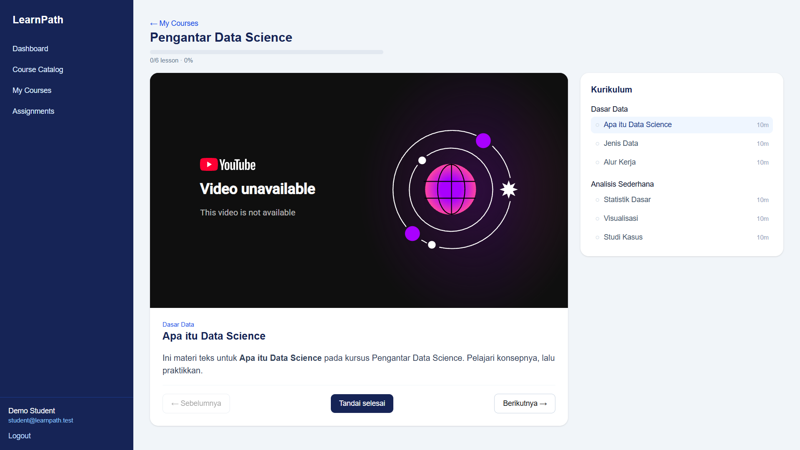
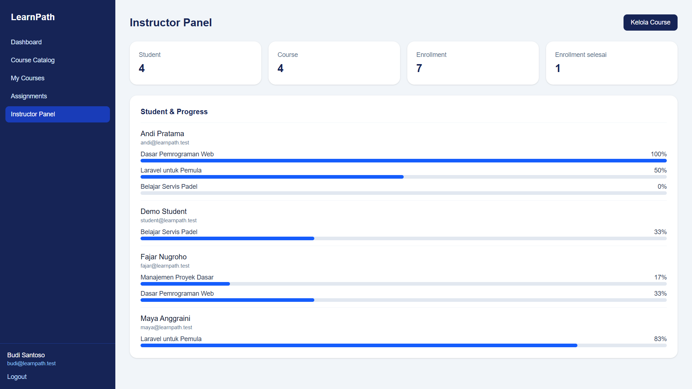

# LearnPath: Mini Learning Management System

Portfolio project: platform belajar online dengan arsitektur frontend dan backend terpisah (Next.js + Laravel REST API).

> Proyek independen untuk portfolio, tidak berafiliasi dengan perusahaan mana pun.

## Screenshots

| Dashboard                                    | Course Catalog                           |
| -------------------------------------------- | ---------------------------------------- |
|  |  |

| Learning                                   | Assignment                                     |
| ------------------------------------------ | ---------------------------------------------- |
|  |  |

| Admin Panel                          | Mobile                                 |
| ------------------------------------ | -------------------------------------- |
|  |  |

## Fitur

**Student**

- Login dengan token (Laravel Sanctum)
- Dashboard: statistik, continue learning, tugas mendatang, aktivitas terakhir
- Katalog course: pencarian, filter kategori, pagination
- Enrollment (cegah duplikasi)
- Learning module: kurikulum, video, materi markdown, prev/next, tandai selesai, resume dari lesson terakhir
- Progress tracking otomatis per course
- Assignment: daftar, detail, submit dan revisi jawaban teks sebelum deadline
- Sertifikat penyelesaian (print / Save as PDF) setelah course 100%

**Instructor dan Admin**

- RBAC tiga role: student, instructor, admin
- Instructor hanya melihat dan mengelola course miliknya; admin melihat semua
- Panel statistik dan progress student (dengan pagination)
- CRUD course (draft / published)
- CRUD modul dan lesson (durasi course tersinkron otomatis)
- CRUD tugas dan melihat jawaban student (read-only)

## Tech Stack

| Layer    | Teknologi                                       |
| -------- | ----------------------------------------------- |
| Frontend | Next.js, React, TypeScript, Tailwind CSS, Axios |
| Backend  | Laravel, PHP, REST API, Sanctum, API Resources  |
| Database | MySQL                                           |
| Testing  | PHPUnit (Laravel Feature Test)                  |

## Arsitektur

```
Next.js (web)  →  REST API (JSON)  →  Laravel (api)  →  MySQL
```

## Struktur Repo

```
learnpath/
├── api/    # Laravel REST API
├── web/    # Next.js frontend
└── docs/   # Screenshot dokumentasi
```

## Cara Menjalankan (Local)

**Prasyarat:** PHP 8.2+, Composer, Node.js, MySQL (XAMPP).

**Backend**

```bash
cd api
composer install
cp .env.example .env
php artisan key:generate
# buat database `learnpath`, lalu sesuaikan DB_* di .env
php artisan migrate:fresh --seed
php artisan serve
```

**Frontend**

```bash
cd web
npm install
# buat .env.local berisi:
# NEXT_PUBLIC_API_URL=http://127.0.0.1:8000/api
npm run dev
```

Buka http://localhost:3000

## Akun Demo

Semua password: `password`

| Role       | Email                                     |
| ---------- | ----------------------------------------- |
| Student    | student@learnpath.test                    |
| Admin      | admin@learnpath.test                      |
| Instructor | budi@learnpath.test / sari@learnpath.test |

Akun `student@learnpath.test` sengaja kosong (belum enroll) untuk demo dari nol. Student dummy lain (andi, rina, dewi, fajar, maya, tono) berisi data progress bervariasi untuk panel admin.

## Testing

```bash
cd api
php artisan test
```

Test memakai database terpisah `learnpath_test` (buat database kosong tersebut dan atur di `phpunit.xml`), sehingga data demo tidak terhapus.

Yang diuji: login, proteksi route, enrollment tanpa duplikasi, otorisasi lesson, idempotensi progress, status completed otomatis, RBAC, dan kepemilikan data per instructor.

## Endpoint Utama

**Student**

| Method | Endpoint                      | Fungsi                                    |
| ------ | ----------------------------- | ----------------------------------------- |
| POST   | /api/login                    | Login                                     |
| POST   | /api/logout                   | Logout                                    |
| GET    | /api/user                     | User saat ini                             |
| GET    | /api/dashboard                | Ringkasan dashboard                       |
| GET    | /api/categories               | Daftar kategori                           |
| GET    | /api/courses                  | Katalog (`search`, `category_id`, `page`) |
| GET    | /api/courses/{slug}           | Detail course                             |
| POST   | /api/courses/{id}/enroll      | Enroll                                    |
| GET    | /api/my-courses               | Course saya                               |
| GET    | /api/courses/{id}/curriculum  | Kurikulum                                 |
| GET    | /api/lessons/{id}             | Detail lesson                             |
| POST   | /api/lessons/{id}/complete    | Tandai selesai                            |
| GET    | /api/courses/{id}/progress    | Progress course                           |
| GET    | /api/courses/{id}/certificate | Data sertifikat (hanya jika 100%)         |
| GET    | /api/my-assignments           | Daftar tugas                              |
| GET    | /api/assignments/{id}         | Detail tugas                              |
| POST   | /api/assignments/{id}/submit  | Kirim tugas                               |

**Admin / Instructor** (prefix `/api/admin`, middleware `role:admin,instructor`)

| Method              | Endpoint                                            | Fungsi                          |
| ------------------- | --------------------------------------------------- | ------------------------------- |
| GET                 | /stats                                              | Statistik                       |
| GET                 | /students                                           | Student dan progress (paginasi) |
| GET/POST/PUT/DELETE | /courses                                            | CRUD course                     |
| GET                 | /courses/{id}/curriculum                            | Kurikulum course                |
| POST/PUT/DELETE     | /courses/{id}/modules, /modules/{id}, /lessons/{id} | Kelola modul dan lesson         |
| GET/POST            | /courses/{id}/assignments                           | Daftar dan buat tugas           |
| PUT/DELETE          | /assignments/{id}                                   | Ubah dan hapus tugas            |
| GET                 | /assignments/{id}/submissions                       | Jawaban student                 |

## Keputusan Teknis

- Frontend dan backend dipisah, berkomunikasi lewat REST API.
- Logika progress dipusatkan di `ProgressService`; persentase dihitung dari data, tidak disimpan, sehingga tidak bisa tidak sinkron.
- Unique constraint di database mencegah enroll, progress, dan submission ganda.
- Otorisasi berlapis: middleware role, lalu pengecekan kepemilikan per course (object-level). Frontend hanya menyembunyikan menu; keamanan sebenarnya ada di backend.
- Konten dan data yang sudah dipakai student tidak bisa dihapus (menjaga integritas progress dan jawaban).
- Course draft tersembunyi dari student, termasuk lewat URL langsung.
- Pagination dilakukan di server, bukan di browser.

## Keterbatasan (di luar scope MVP)

- Token disimpan di localStorage; untuk produksi sebaiknya cookie httpOnly (rencana pengembangan).
- Belum ada penilaian/feedback tugas dan upload file.
- Belum ada drag-and-drop urutan modul/lesson.
- Sertifikat belum punya halaman verifikasi publik.
- Belum ada deployment (dijalankan lokal).
