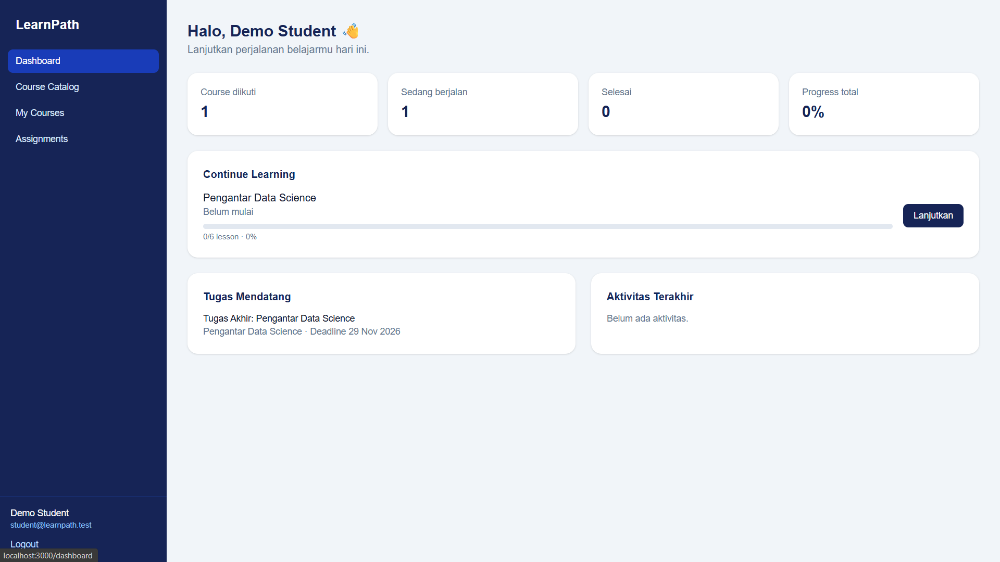
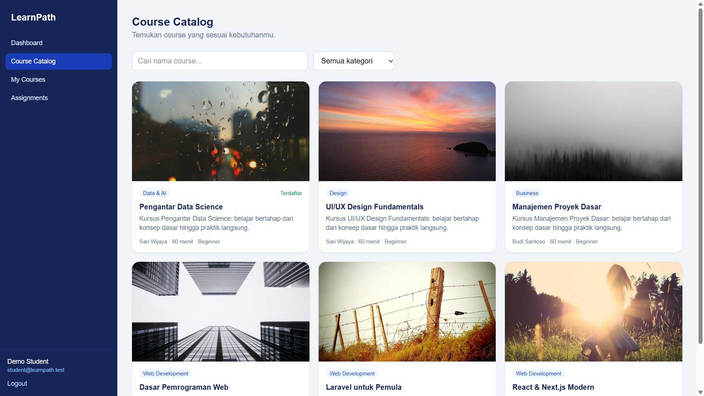
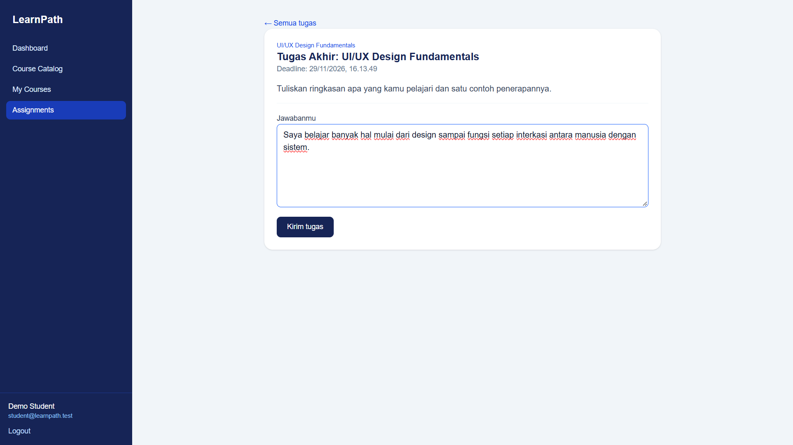
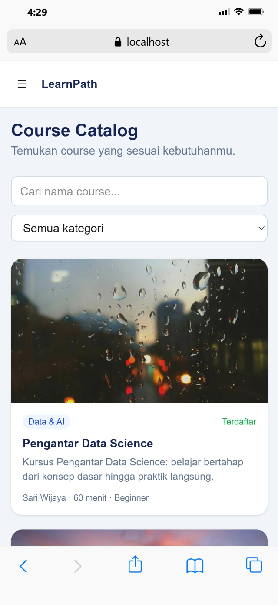

# LearnPath: Mini Learning Management System

Portfolio project: platform belajar online sederhana dengan arsitektur frontend dan backend terpisah.

> Proyek independen untuk portfolio, tidak berafiliasi dengan perusahaan mana pun.

## Fitur

- Login dengan token (Laravel Sanctum)
- Dashboard student: statistik, continue learning, tugas mendatang, aktivitas terakhir
- Katalog course dengan pencarian dan filter kategori
- Enrollment (cegah duplikasi)
- Learning module: kurikulum, video, materi markdown, prev/next, tandai selesai, resume dari lesson terakhir
- Progress tracking otomatis per course
- Assignment: daftar, detail, submit jawaban teks
- Role-based access control: panel admin untuk statistik dan progress student
- RBAC tiga role (student, instructor, admin) dengan pembatasan data per instructor

## Screenshots

| Dashboard                                    | Course Catalog                           |
| -------------------------------------------- | ---------------------------------------- |
|  |  |

| Learning                                   | Assignment                                     |
| ------------------------------------------ | ---------------------------------------------- |
|  |  |

| Admin Panel                          | Mobile                                 |
| ------------------------------------ | -------------------------------------- |
|  |  |

## Tech Stack

| Layer    | Teknologi                                       |
| -------- | ----------------------------------------------- |
| Frontend | Next.js, React, TypeScript, Tailwind CSS, Axios |
| Backend  | Laravel, PHP, REST API, Sanctum                 |
| Database | MySQL                                           |

## Arsitektur

```
Next.js (web)  →  REST API (JSON)  →  Laravel (api)  →  MySQL
```

## Struktur Repo

```
learnpath/
├── api/   # Laravel REST API
└── web/   # Next.js frontend
```

## Cara Menjalankan (Local)

**Prasyarat:** PHP 8.2+, Composer, Node.js, MySQL (XAMPP).

**Backend**

```bash
cd api
composer install
cp .env.example .env
php artisan key:generate
# buat database `learnpath`, lalu sesuaikan DB_* di .env
php artisan migrate:fresh --seed
php artisan serve
```

**Frontend**

```bash
cd web
npm install
# buat .env.local berisi:
# NEXT_PUBLIC_API_URL=http://127.0.0.1:8000/api
npm run dev
```

Buka http://localhost:3000

## Akun Demo

| Role       | Email                  | Password |
| ---------- | ---------------------- | -------- |
| Student    | student@learnpath.test | password |
| Admin      | admin@learnpath.test   | password |
| Instructor | budi@learnpath.test    | password |

## Endpoint Utama

| Method | Endpoint                     | Fungsi                                  |
| ------ | ---------------------------- | --------------------------------------- |
| POST   | /api/login                   | Login                                   |
| POST   | /api/logout                  | Logout                                  |
| GET    | /api/user                    | User saat ini                           |
| GET    | /api/dashboard               | Ringkasan dashboard                     |
| GET    | /api/courses                 | Daftar course (`search`, `category_id`) |
| GET    | /api/courses/{slug}          | Detail course                           |
| POST   | /api/courses/{id}/enroll     | Enroll                                  |
| GET    | /api/my-courses              | Course saya                             |
| GET    | /api/courses/{id}/curriculum | Kurikulum                               |
| GET    | /api/lessons/{id}            | Detail lesson                           |
| POST   | /api/lessons/{id}/complete   | Tandai selesai                          |
| GET    | /api/courses/{id}/progress   | Progress course                         |
| GET    | /api/my-assignments          | Daftar tugas                            |
| GET    | /api/assignments/{id}        | Detail tugas                            |
| POST   | /api/assignments/{id}/submit | Kirim tugas                             |

## Keputusan Teknis

- Frontend dan backend dipisah, berkomunikasi lewat REST API.
- Logika progress dipusatkan di `ProgressService`, persentase dihitung dari data (tidak disimpan).
- Unique constraint di database mencegah enroll, progress, dan submission ganda.
- Otorisasi: hanya student terdaftar yang bisa mengakses lesson dan assignment course tersebut.

## Keterbatasan (di luar scope MVP)

- Upload file, sertifikat, pembayaran.
- Token disimpan di localStorage; untuk produksi sebaiknya cookie httpOnly.
- Belum ada deployment.

## Testing

```bash
cd api
php artisan test
```

Test memakai database terpisah `learnpath_test` (buat database kosong tersebut dan atur di `phpunit.xml`).
